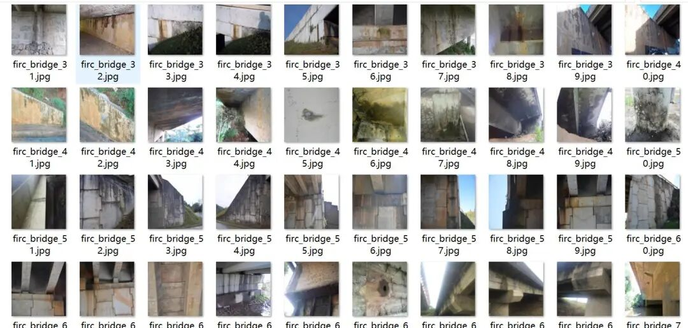
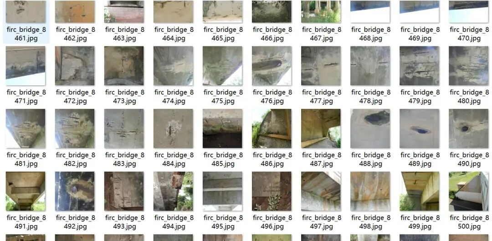
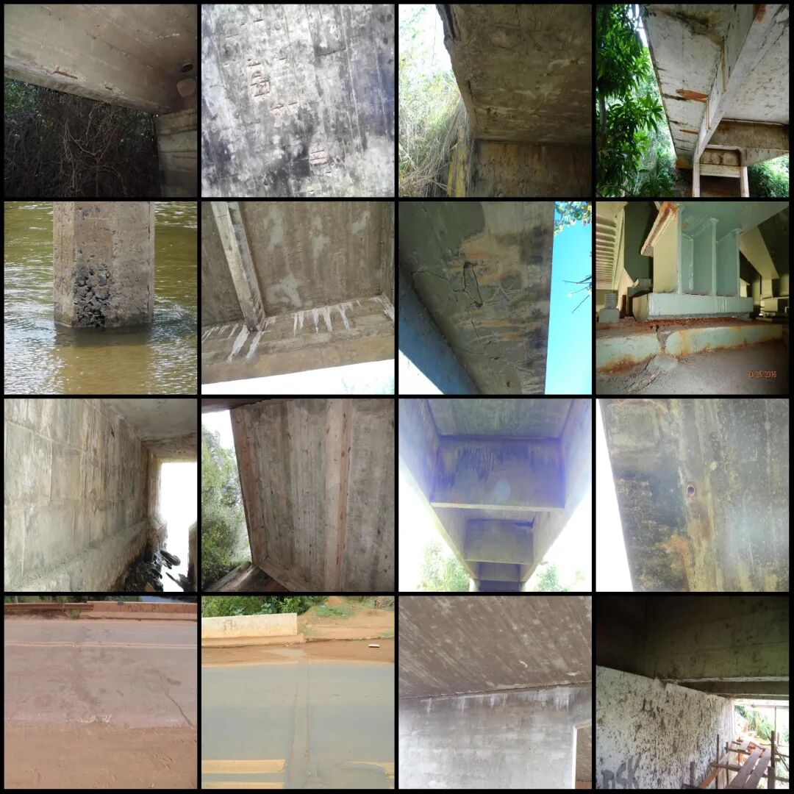
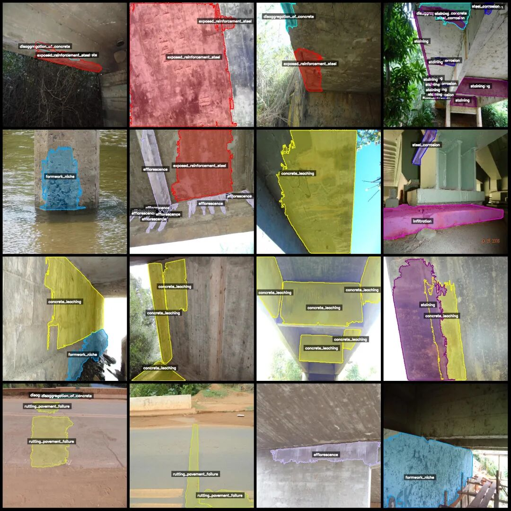
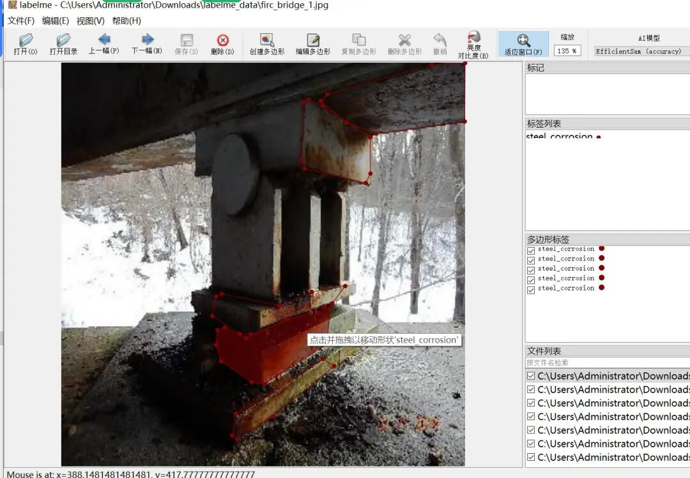

# Bridge concrete damage, cracks, voids, scaling defects, and segmentation dataset - labelme format: 9398 images, 18 categories

Dataset format: labelme format (without mask files, only including jpg images and corresponding json files)

Number of images (number of jpg files): 9398

Number of annotations (number of json files): 9398

Labeling category count: 18

Label category name:["steel_corrosion","exposed_reinforcement_steel","infiltration","staining","crack","efflorescence","concrete_leaching","disaggregation_of_concrete","deep_crack","embankment_erosion","expansion_joint","rutting_pavement_failure","pothole_asphalt","faunal_biodegradation","fire_damaged","guardrail_damaged","formwork_niche","broken_drain"]

Number of boxes labeled in each category:

Steel Corrosion (Rebar Rust) count = 1249

Exposed Reinforcement Steel (Steel Brackets Exposed) Count = 3755

Infiltration (Leakage) count = 1807

Staining (stain) count = 5198

Crack count = 796

Efflorescence (sponge) count = 5466

concrete_leaching (Concrete percolation) count = 6762

Disaggregation of concrete (Concrete segregation) count = 1681

Deep_crack (deep crack) count = 183

Embankment Erosion (Count = 464)

Expansion joint (expansion joint) count = 462

rutting_pavement_failure (road surface rutting failure) count = 977

Pothole Asphalt (Asphalt Pothole) count = 683

Faunal Biodegradation (Biodegradation) count = 1802

fire_damaged (Fire Damaged) count = 83

guardrail_damaged (guardrail damage) count = 415

Formwork niche (template hole) count = 993

broken_drain (Broken drain) count = 201

Total frame count: 32977

Using labeling tool: labelme=5.5.0

Application Domain: Detection of defects and deterioration in concrete structures such as bridges, tunnels, or buildings, along with related infrastructure.

Image resolution: 640x640

Annotation rules: Draw polygons around the categories.

Important Notice: The dataset can be opened and edited using LabelMe. For JSON datasets, one must convert them into mask or YOLOF format or COCO format for semantic segmentation or instance segmentation.

Special : This dataset does not guarantee the accuracy of the trained models or weight files.

Image Preview:

Annotation example:

Original image (pick 16 images at random for display):

Annotation:

LabelMe editing an image example:

## Payment

Here is a pay link on Stripe ( https://buy.stripe.com/3cs8yP7sY87d0vu9AB ). Please contact me lonlonago@foxmail.com after funding $89, and I will send you a complete data files , thank you!

